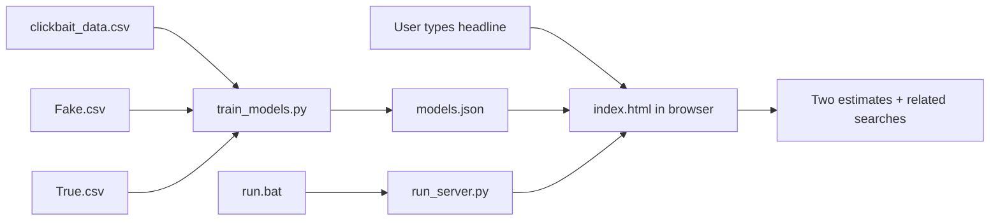

# Build Signal Check Yourself

This guide explains how to recreate the project in small steps. The complete working code is in the linked files; use this guide to understand what each part does before copying or rewriting it.

## The project in one picture



The Python program learns word patterns from your CSV files. The browser page compares a new headline with those learned patterns. It does not prove whether a story is true.

## The files to create

Make a project folder with these files:

```text
SignalCheck/
├── index.html
├── models.json          # created by train_models.py
├── train_models.py
├── run_server.py
├── run.bat
├── .gitignore           # keeps local CSVs and Python cache out of Git
├── data/                # put your CSVs here locally; don't publish them by default
└── README.md
```

The full working source is available here:

- [index.html — complete HTML, CSS, and browser JavaScript](index.html)
- [train_models.py — complete training program](train_models.py)
- [run_server.py — local web server](run_server.py)
- [run.bat — Windows launcher](run.bat)
- [models.json — trained model weights](models.json)

## Step 1: Decide what the app should do

Write down the input and output before you code:

- **Input:** one headline.
- **Clickbait output:** a model estimate for clickbait vs. non-clickbait.
- **Fake/true output:** a separate estimate comparing the headline to examples labelled fake and true in the supplied files.
- **Related coverage:** search links based on the headline.

Keep clickbait and fake/true separate. A headline can be clickbait-style without being false, and a neutral-sounding headline can still be false.

## Step 2: Inspect the CSV files

The clickbait file has `headline` and `clickbait` columns. Its labels are `1` for clickbait and `0` for non-clickbait.

`Fake.csv` and `True.csv` both have a `title` column. This project uses the filename as the label and trains only on `title`, because the app only asks the user for a headline.

In Python, the built-in `csv` module reads a CSV without installing anything:

```python
import csv

with open("data/clickbait_data.csv", encoding="utf-8-sig", newline="") as file:
    rows = csv.DictReader(file)
    print(rows.fieldnames)  # names of the columns
    for row in rows:
        print(row["headline"], row["clickbait"])
        break
```

The real project handles all rows, empty values, labels, duplicate headlines, and conflicting labels in `read_clickbait()` and `read_fake_real()` in [train_models.py](train_models.py).

## Step 3: Clean headlines and create features

Computers need a consistent representation of text. The trainer normalizes Unicode, lowercases words for matching, and tokenizes a headline. It creates three kinds of features:

1. **Unigrams:** single words, such as `u:shocking`.
2. **Bigrams:** neighboring word pairs, such as `b:what_happened`.
3. **Style features:** punctuation, capital letters, numbers, quotes, ellipses, and headline length.

The key idea in simplified Python is:

```python
import re

TOKEN_RE = re.compile(r"[a-z0-9]+(?:'[a-z0-9]+)?")

def words_in(headline):
    return TOKEN_RE.findall(headline.lower())

def features(headline):
    words = words_in(headline)
    unigrams = ["u:" + word for word in words if len(word) > 1]
    bigrams = ["b:" + left + "_" + right
               for left, right in zip(words, words[1:])]
    return unigrams + bigrams
```

The complete `features()` function also adds the style features. The browser has a matching JavaScript version in `featureCounts()` in [index.html](index.html). The training code and browser code must produce the same feature names, or the browser won’t find the model’s weights.

## Step 4: Split the data before training

The project makes three groups, keeping examples from each class represented in each group:

- 70% to learn model weights
- 15% to calibrate its displayed estimate
- 15% to measure performance on headlines it did not train on

It removes duplicate headlines before splitting. If duplicates appeared in both training and holdout data, evaluation could look better than the model really is because it had already seen the same headline.

The split is randomized with a fixed seed (`42`), so retraining on the same files gives the same split. See `split_records()` in the training script.

## Step 5: Train the two Naive Bayes models

The code uses Multinomial Naive Bayes. In plain language, it asks: “How common is this word or style feature in class A compared with class B?”

For each feature and class, it counts occurrences. It uses **Laplace smoothing** (`ALPHA = 1`) so an unseen feature doesn’t create a zero probability. The trainer ignores features found in only one headline and caps each vocabulary at 30,000 features.

The model stores a log-weight for each feature:

```text
weight(feature) = log(P(feature | positive class) / P(feature | negative class))
```

A positive weight supports the positive label; a negative weight supports the other label. The headline score adds the prior class balance and the weights for its features:

```text
score = log(prior odds) + sum(feature count × feature weight)
```

The trainer does this twice:

- **Clickbait model:** positive label is `clickbait`; negative label is `not clickbait`.
- **Fake/true model:** positive label is `Fake.csv`; negative label is `True.csv`.

The exact implementation is in `train_nb()` in [train_models.py](train_models.py).

## Step 6: Calibrate and measure the model

Naive Bayes raw scores can become very large, so the program uses the calibration group to fit a sigmoid that turns a score into a more readable estimate between 0% and 100%.

It then predicts the holdout group and calculates:

- **Accuracy:** fraction of all holdout headlines classified correctly.
- **Precision:** when the model predicts the positive class, how often that label matches the dataset.
- **Recall:** how many of the positive-labelled holdout examples it finds.
- **F1:** a combined precision/recall measure.

For these files, the current holdout accuracy is about **97.8%** on the clickbait dataset and **95.5%** on the fake/true dataset. This measures performance on a split of the supplied files. It does **not** mean that the app is 95.5% accurate about all real-world news.

## Step 7: Save the trained model

The training script writes a JSON file named `models.json`. JSON is a text format that JavaScript can load easily. It contains the vocabulary weights, calibration values, and holdout report; it does not copy the article rows into the app.

To regenerate it, open Command Prompt in the project folder and run:

```text
python train_models.py
```

The script expects CSV files in its local `data` folder. If yours are elsewhere, give explicit paths:

```text
python train_models.py --clickbait "C:\path\clickbait_data.csv" --fake "C:\path\Fake.csv" --true "C:\path\True.csv"
```

## Step 8: Build the webpage structure with HTML

HTML describes the page’s content and controls. Start with a headline input, two buttons, and a results area:

```html
<label for="headline">Paste a headline</label>
<textarea id="headline" maxlength="280"></textarea>
<button id="analyze" type="button">Check this headline</button>
<button id="sample" type="button">Try an example</button>
<section id="results" aria-live="polite"></section>
```

The full `index.html` adds the header, explanatory text, accessible labels, cards, result meters, privacy note, and footer.

## Step 9: Style it with CSS

CSS controls how the HTML looks. In `index.html`, the `<style>` block defines colors and reusable design values near the top:

```css
:root {
  --paper: #f4f1e9;
  --ink: #172a28;
  --green: #176c58;
}

.panel {
  background: #fffefa;
  border-radius: 21px;
  border: 1px solid #dce2d9;
}
```

The rest styles the layout, buttons, score bars, evidence chips, mobile screen sizes, and keyboard focus. The `@media` rules change the two-column layout into one column on a narrow screen.

## Step 10: Add browser behavior with JavaScript

JavaScript connects the buttons to the model:

1. `loadModels()` fetches `models.json` and enables the buttons after it loads.
2. `analyzeHeadline()` reads the text and calls each model separately.
3. `featureCounts()` creates the same unigrams, bigrams, and style features as Python.
4. `predict()` adds the model weights and applies calibration.
5. `renderModelResult()` writes both estimates, influential terms, and holdout accuracy into the page.
6. `makeCoverageLinks()` makes Google News, AP News, and fact-check search links.

The key calculation in JavaScript is the same weighted sum as the trainer:

```javascript
let score = Number(model.bias);
for (const [feature, count] of Object.entries(featureCounts(headline))) {
  score += Number(model.weights[feature] || 0) * count;
}
```

The browser then applies the model’s calibration values to turn that score into an estimate.

## Step 11: Run it locally

Browsers may block JavaScript `fetch()` from a page opened directly as `file://`. That is why this project uses a local web server.

`run_server.py` uses Python’s built-in `http.server` module. It binds only to your own computer (`127.0.0.1`), chooses an available port, serves the project files, and opens `index.html` in your browser.

`run.bat` is a Windows command file. It changes to its own folder, finds `python` (or the `py` launcher), and runs `run_server.py`. Double-click **run** in File Explorer and keep its command window open. Press Ctrl+C in that window to stop the server.

## Step 12: Share the app

To let people use it through a link, publish `index.html` and `models.json` together on a static host. Include `README.md` if you want people to understand how it works. The local launcher files are not required for a hosted site.

Check the dataset licenses before publishing the trained model or the original CSV files. The app needs the model JSON to run; it does not need the raw CSVs after training.

## Important limitation

`Fake.csv` and `True.csv` are the source of the fake/true labels. The model learns patterns in those labels and may also learn topic, date, or publisher clues. A headline’s resemblance to one dataset class is not an independent fact-check. The responsible next version would compare article claims with current reporting and show its sources.

## A good way to practice

Rebuild one part at a time rather than typing the entire app at once:

1. Make a tiny HTML page with only the textarea and two buttons.
2. Add CSS to make the form readable on phone and desktop.
3. Write a Python program that reads one CSV and prints a few prepared rows.
4. Add deduplication and the data split.
5. Add feature extraction, train one model, and measure it on holdout data.
6. Add the second model and export JSON.
7. Load the JSON in JavaScript and display one prediction.
8. Add evidence terms, coverage links, privacy copy, and the local launcher.

After each step, compare your file with the complete code linked at the start of this guide.
